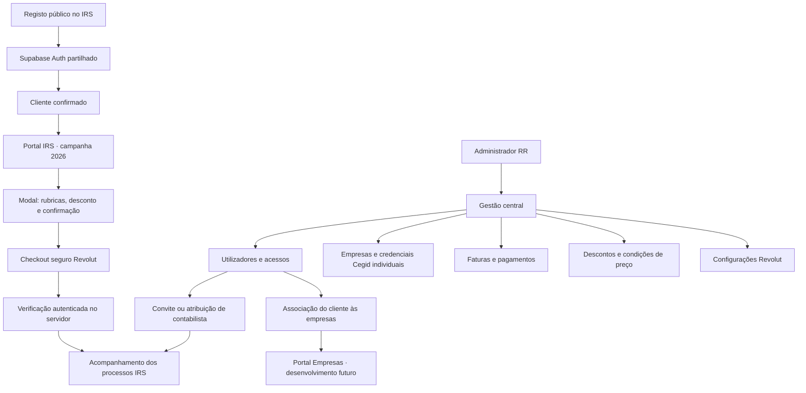

# Gestão e clientes

O registo público cria apenas uma identidade cliente. O perfil contabilista depende de uma atribuição administrativa registada na base de dados, não de metadados editáveis no registo. Apenas o administrador gere utilizadores, empresas, credenciais e condições comerciais; os profissionais convidados acompanham os processos IRS.

O Supabase contém a identidade comum. Cada aplicação mantém a sua própria sessão e interface. O futuro portal Empresas deverá consultar as associações a empresas, sem inferir acessos a partir de uma conta no IRS.

Os ficheiros mantêm-se em Storage privado; o PostgreSQL guarda os metadados. As credenciais por empresa e da Revolut são cifradas com AES-256-GCM no servidor e ficam numa tabela sem permissões para anon/authenticated, incluindo o utilizador administrador. O servidor só as escreve após verificar o administrador. A chave de cifragem fica nas variáveis privadas Vercel de ambas as aplicações.

Não existe seletor de exercícios. A campanha atual é IRS 2026. O campo técnico `tax_year` é preservado, tal como todos os processos existentes. A migração não executa limpezas nem agenda emails para a campanha seguinte. As decisões sobre conservação e reaproveitamento do agregado ficam para essa preparação.
